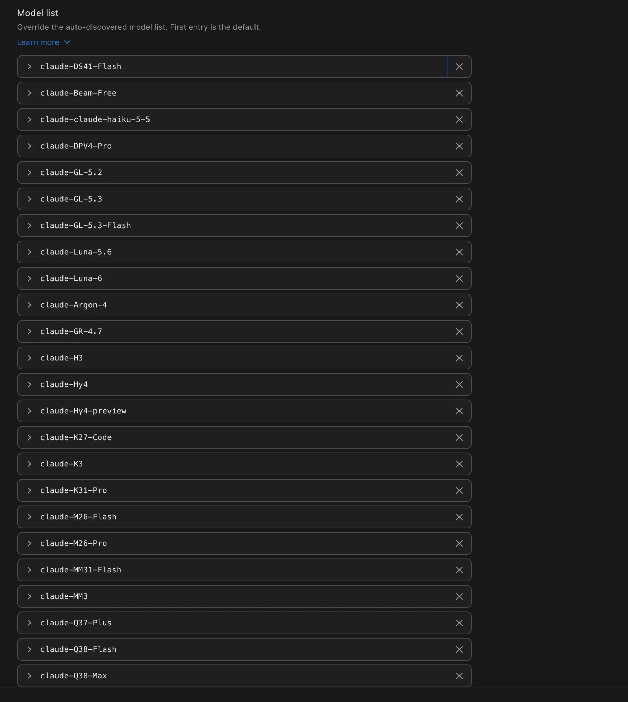
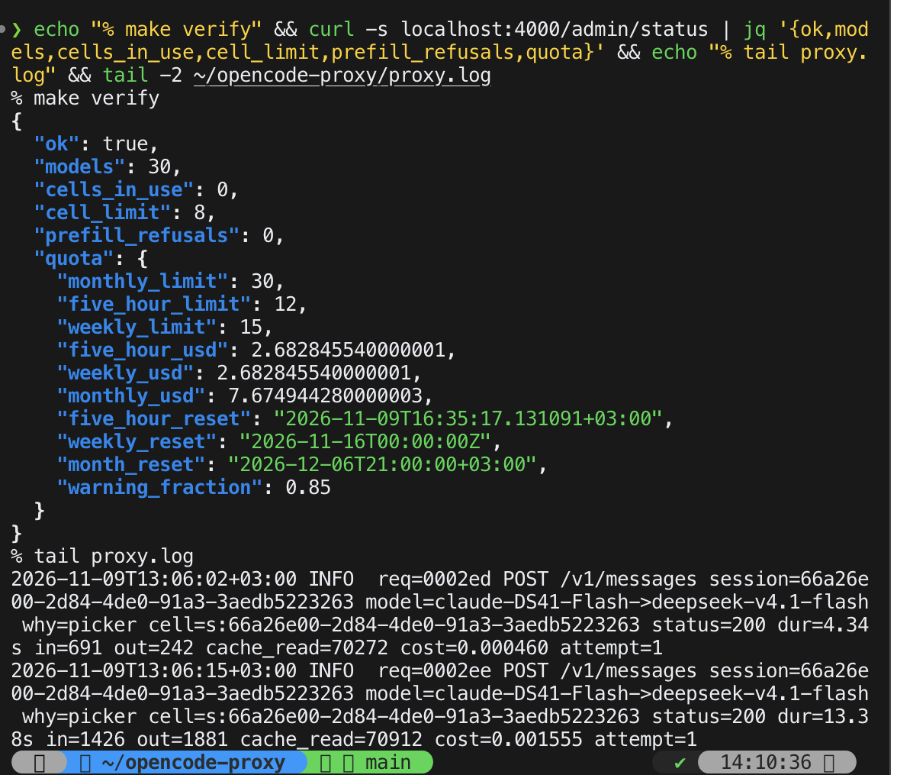

# opencode-proxy

A local reverse proxy that puts the [OpenCode Go](https://opencode.ai/docs/console/go) model
catalog — 30 models: GLM, DeepSeek, Kimi, Qwen, MiniMax and friends — into Claude Desktop and
Claude Code, and makes it survive real traffic: per-agent cell scheduling, automatic retries,
quota accounting and a REST control plane, all on one port.

```
Claude Desktop / Claude Code CLI
        │  Anthropic API (/v1/messages)
        ▼
opencode-proxy  127.0.0.1:4000
  ├─ model resolver     aliases · claude-* → native ids · never silently swaps a picked model
  ├─ cell scheduler     one request per agent chain · priority main > subagent > aux
  │                     adaptive ceiling learned from prefill refusals · reset after compaction
  ├─ retries            exponential ladder · Retry-After · x-should-retry · SSE keepalive pings
  ├─ quota ledger       allowance from every response → 5-hour / weekly / monthly windows
  ├─ live catalog       gateway /v1/models fetched with a 10 min TTL, unknown ids resolve
  └─ structured log     one key=value line per request · size rotation · optional capture .jsonl
        │
        ▼
https://opencode.ai/inference/go/anthropic
```

Same port, never forwarded upstream: `GET /v1/models` (picker discovery), `POST /search`
(web search bridge), `HEAD /api/hello`, and the whole `/admin/*` REST surface.

## Why

The desktop app points at the OpenCode Go gateway, but out of the box it forced a single model
through a hand-edited config, and five parallel subagents collided on one upstream cell — the
gateway answered every request with `429 prefill_cap_refused` while the UI hung silently. The
proxy exists to fix exactly that: every model of the catalog visible in the picker, every agent
chain on its own cell, every retry hidden from the user, and every cent of the monthly allowance
accounted for.

## Quick start

Requirements: macOS (launchd), Go.

```bash
git clone https://github.com/olegshirko/opencode-proxy.git
cd opencode-proxy
make install     # test → smoke on a spare port → swap the binary → launchd agent
make verify      # curl the admin status; the service answers on 127.0.0.1:4000
```

`config.json` ships with working defaults; the proxy forwards whatever credentials your client
already sends. Nothing outside the machine can reach it — the listener is loopback-only.

## The model picker

`models.json` is the single source of truth: native ids, picker names, prices, availability.
It regenerates itself from the live gateway catalog (including a region probe) with:

```bash
make models      # reads the token from ~/.claude/settings.json, probes all models
```

The `claude-config` skill (`.claude/skills/claude-config/`) turns `models.json` into the
desktop app's gateway profile — picker entries, per-model pricing, context windows. Restart
the app after regenerating: profiles are read at startup.



## Observability

One line per request:

```
2026-11-09T13:06:15+03:00 INFO  req=0002ee POST /v1/messages session=66a26e00… model=claude-DS41-Flash->deepseek-v4.1-flash why=picker cell=s:66a26e00… status=200 dur=13.38s in=1426 out=1881 cache_read=70912 cost=0.001555 attempt=1
```

`why` is the mapping source (`alias`, `picker`, `native`, `background`, `default`, `catalog`).
Four independent `log.capture` switches dump full request/response bodies to a rotated
`proxy.log.jsonl`, correlated by `req`.

The status line in Claude Code shows real session cost next to the Go plan's usage:

```
$0.48 · 406 req · month $2.78 · W 37% · D 53% · M 18% · DeepSeek v4.1 Flash
```

Build and register it:

```bash
make statusline
# then in ~/.claude/settings.json:
# "statusLine": { "type": "command", "command": "/…/opencode-proxy/bin/statusline" }
```

The quota windows (5-hour 40%, weekly 50%, monthly 100% of the monthly limit) were verified
twice against the OpenCode panel — percentages match to the whole percent.

## Admin API

| Method | Path | What it does |
|---|---|---|
| `GET`  | `/admin/status` | health, cells, queue, counters, quota windows |
| `GET` / `PATCH` | `/admin/config` | read / partially update the config; hot-reloaded from disk too |
| `GET` / `PUT` | `/admin/models/aliases` | inspect / replace the alias table |
| `POST` | `/admin/reload` | re-read `config.json` |
| `GET`  | `/admin/session-cost?session=…` | per-session cost, requests, per-model breakdown |

Optional `admin.token` locks the surface behind an `X-Admin-Token` header.



## Web search

Anthropic's server-side `WebSearch` is not exposed behind a third-party gateway, so the proxy
ships two bridges to the local OpenCode search (exa, tavily, firecrawl, parallel, tinyfish):

- `POST /search` — for the desktop app's search connector;
- `cmd/oc-search-mcp` — a stdio MCP server with a `search` tool for Claude Code:

```bash
go build -o bin/oc-search-mcp ./cmd/oc-search-mcp
claude mcp add --scope user oc-search -- "$PWD/bin/oc-search-mcp"
```

## Design docs

- [`docs/2026-11-07-opencode-proxy-design.md`](docs/2026-11-07-opencode-proxy-design.md) — the full design: resolver order, retry policy, logging, admin API
- [`docs/2026-11-07-agent-cells-and-native-compat.md`](docs/2026-11-07-agent-cells-and-native-compat.md) — cell keys, scheduler, quota windows, thinking plates
