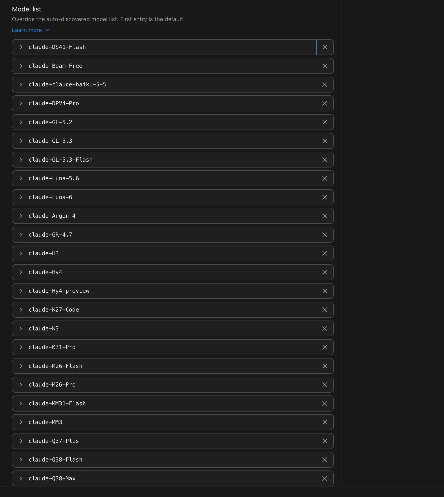
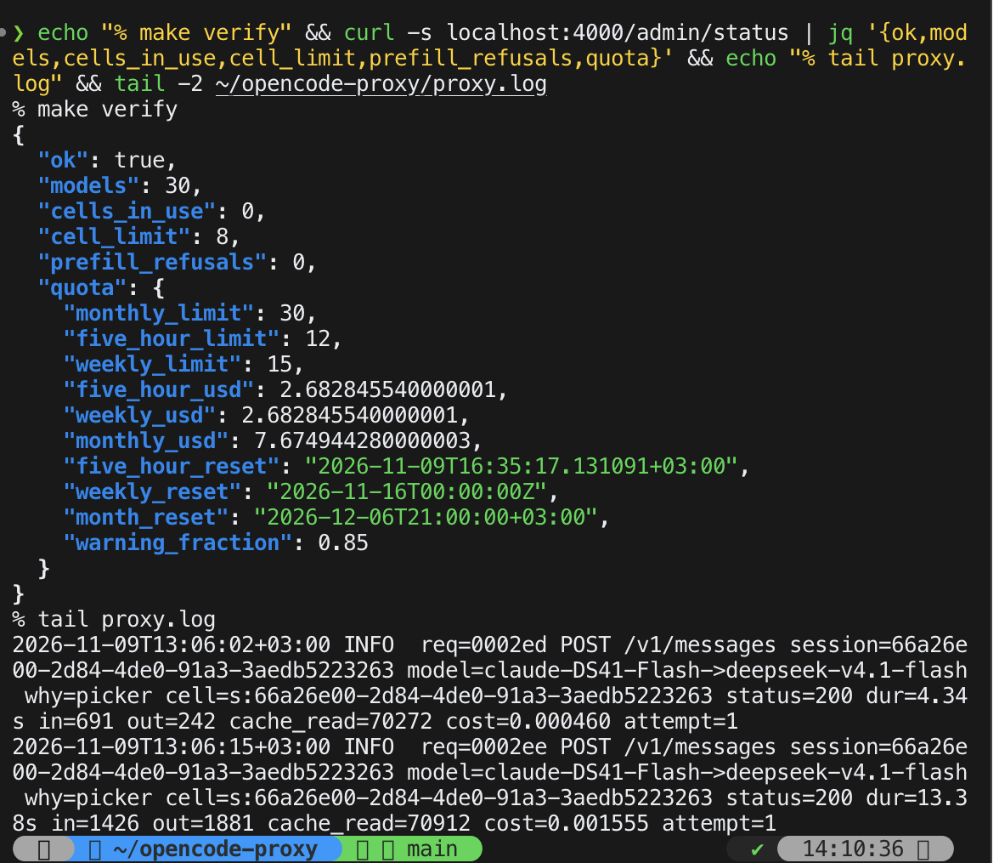

# opencode-proxy

[English](README.md) | Русский

Локальный reverse-прокси, который открывает каталог моделей
[OpenCode Go](https://opencode.ai/docs/console/go) — 30 моделей: GLM, DeepSeek, Kimi,
Qwen, MiniMax и другие — для Claude Desktop и Claude Code, и держит их работающими под
реальной нагрузкой: параллельные агенты получают собственные ячейки апстрима, отказы
гейтвея незаметно ретраятся, и каждый цент месячного лимита учтён. Один Go-бинарник,
без зависимостей.

| Платформа | Поддержка |
|---|---|
| macOS | Полная: сервис, профиль десктоп-приложения, строка статуса, поиск, ночное обновление |
| Linux | Полная для Claude Code CLI: systemd user service, пикер моделей, строка статуса, поиск |
| Windows | Планируется (фаза 2) |

## Зачем

Из коробки Claude Desktop смотрит на гейтвей OpenCode Go, но показывает одну модель,
пять параллельных субагентов сталкиваются на одной ячейке апстрима (гейтвей отвечает
на каждый запрос `429 prefill_cap_refused`, а UI молча висит), и ничто не говорит,
сколько лимита осталось. Прокси чинит именно это:

| Без прокси | С прокси |
|---|---|
| Одна навязанная модель | Все 30 моделей каталога в пикере, каждая под своим нативным id |
| Параллельные агенты отказывают друг другу | Каждая цепочка агентов получает свою ячейку; главный поток всегда выигрывает очередь |
| UI висит, пока гейтвей занят | Ретраи с SSE keepalive-пингами — клиент всегда видит прогресс |
| Непонятно, что позволяет тариф | Окна 5 часов / неделя / месяц, сверенные с панелью OpenCode |
| `WebSearch` недоступен за гейтвеем | Поисковый мост: коннектор десктоп-приложения и MCP-инструмент для Claude Code |
| Стоимость не видна | Строка статуса: реальная стоимость сессии плюс проценты W/D/M, вживую |

<!-- скриншот: выпадающий пикер (docs/img/picker.png) -->



<!-- скриншот: строка статуса (docs/img/statusline.png) -->

<!-- скриншот: вывод make install (docs/img/install.png) -->

## Быстрый старт с нуля

Требования: [Go 1.27+](https://go.dev), git. Всё ниже запускается на машине
пользователя; ничего не слушает наружу loopback. Первый старт сам создаёт конфиг
с рабочими дефолтами — писать конфигурацию руками не нужно.

### macOS

```bash
brew install go                      # пропустите, если Go уже установлен
git clone https://github.com/olegshirko/opencode-proxy.git
cd opencode-proxy
make install                         # тесты → smoke-прогон → launchd-агент на 127.0.0.1:4000
make verify                          # админ-статус отвечает; прокси жив
```

`make install` не трогает работающий сервис, пока кандидат не пройдёт набор тестов
и не ответит на запасном порту; текущие запросы дорабатывают при рестарте.

**Десктоп-приложение.** Claude Desktop общается с прокси через gateway-профиль:
`inferenceGatewayBaseUrl: http://127.0.0.1:4000`. Скилл `claude-config` в этом
репозитории генерирует весь профиль из `models.json` (записи пикера, цены, окна
контекста). Без скилла тоже работает профиль с одним полем, указывающим на прокси —
список моделей тогда отдаётся вживую на `GET /v1/models`. CLI Claude Code использует
тот же прокси — см. [Claude Code](#claude-code) ниже.

**Держать каталог свежим (опционально).** `models.json` перегенерируется каждую ночь
в 04:17 — launchd-таймер забирает живой каталог и пробует доступность; работающий
прокси перечитывает файл за секунды, без рестарта. Установить (в `make install`
не входит):

```bash
make timer                           # запускается ежедневно; лог: var/genmodels.log
make timer-uninstall
```

### Linux

```bash
git clone https://github.com/olegshirko/opencode-proxy.git
cd opencode-proxy
make install                         # тесты → smoke-прогон → systemd user service на 127.0.0.1:4000
make verify                          # админ-статус отвечает; прокси жив
```

Сервис работает от вашего пользователя (`systemctl --user`), ставится в
`~/.local/bin`, конфиг держит в `~/.config/opencode-proxy`, состояние —
в `~/.local/state/opencode-proxy`. Для headless-машины: `loginctl enable-linger`.

Дальше настройте CLI в разделе [Claude Code](#claude-code) ниже — шаги одинаковы
на обеих платформах.

**Обновление**: `git pull && make install`.

## Claude Code

Прокси говорит на Anthropic API, поэтому Claude Code не нужны патчи и обёртки —
только две переменные окружения. Одинаково на macOS и Linux. Предварительные условия:
действующая подписка OpenCode Go и запущенный прокси (`make install` + `make verify`
из быстрого старта выше).

### 1. Направить Claude Code на прокси

Установите CLI, если его нет (`npm install -g @anthropic-ai/claude-code`), затем
добавьте это в `~/.claude/settings.json` — сохранив всё, что там уже есть:

```json
{
  "env": {
    "ANTHROPIC_BASE_URL": "http://127.0.0.1:4000",
    "ANTHROPIC_AUTH_TOKEN": "<ваш токен OpenCode Go>"
  }
}
```

Токен берётся из вашей подписки [OpenCode Go](https://opencode.ai/docs/console/go);
прокси пробрасывает его на гейтвей без изменений, логин Claude.ai не участвует.
Для разового запуска можно экспортировать те же две переменные в шелле вместо
правки файла.

Перезапустите Claude Code и отправьте сообщение — оно уже идёт через прокси. Без
пикера встроенные имена моделей резолвятся в `models.default` из `config.json`,
а фоновые задачи (`claude-haiku-*`) — в `models.background`.

### 2. Добавить пикер моделей

Пикер заменяет встроенный список моделей Claude Code каталогом гейтвея:

```bash
make models                          # пробует доступность токеном из шага 1
make settings                        # печатает env + modelPicker
```

Добавьте напечатанный блок в `~/.claude/settings.json`, замените плейсхолдер токена,
перезапустите Claude Code — `/model` теперь показывает каталог, каждая запись под
своим нативным id. Модели, которые ваш регион не отдаёт, исключены; перезапускайте
обе команды в любой момент для повторной пробы. Прокси подхватывает
перегенерированный `models.json` за секунды, без рестарта.

### 3. Строка статуса (опционально)

Реальная стоимость сессии плюс проценты лимита 5 часов / неделя / месяц, вживую:

```bash
make statusline
```

Затем в `~/.claude/settings.json`:

```json
{
  "statusLine": { "type": "command", "command": "/путь/до/opencode-proxy/bin/statusline" }
}
```

### 4. Веб-поиск (опционально)

`WebSearch` за гейтвеем недоступен; MCP-мост возвращает его:

```bash
go build -o bin/oc-search-mcp ./cmd/oc-search-mcp
claude mcp add --scope user oc-search -- "$PWD/bin/oc-search-mcp"
```

Мост ходит в локальный OpenCode CLI (`opencode api`) — поставьте
[OpenCode](https://opencode.ai), если нужен поиск.

### Проверка

```bash
make verify                          # прокси жив
tail -f var/proxy.log                # по строке на каждый запрос Claude Code
```

## За что отвечает каждая часть

```
Claude Desktop / Claude Code CLI
        │  Anthropic API (/v1/messages)
        ▼
opencode-proxy  127.0.0.1:4000
        │
        ▼
https://opencode.ai/inference/go/anthropic
```

Каждая коробка средней строки — один пакет в `internal/`, и у каждого есть причина
существовать:

| Пакет | Зачем существует |
|---|---|
| `proxy` | Обработчик запросов: резолвит модель, стримит SSE обратно, владеет циклом ретраев и отдаёт admin API, discovery `/v1/models`, `/search` и локальный роутер |
| `models` | Реестр: мапит имена пикера `claude-*` на нативные id гейтвея. Выбранная модель никогда не подменяется молча — каждый маппинг логируется с причиной |
| `scheduler` | Ключи ячеек по цепочкам и очередь с приоритетами: параллельные субагенты перестают отказывать друг другу по prefill, главный поток никогда не ждёт фоновую работу, а потолок конкурентности выучивается из отказов самого гейтвея |
| `retry` | Лестница ретраев с джиттером: уважает `Retry-After` и вердикт гейтвея `x-should-retry` вместо угадывания |
| `quota` | Превращает лимит каждого ответа в окна 5 часов / неделя / месяц и заголовки `anthropic-ratelimit-*` — проценты совпадают с панелью OpenCode до целого процента |
| `coststore` | Стоимость по сессиям, переживающая рестарты: у возвращённой сессии счётчик не обнуляется |
| `catalog` | Живой список моделей гейтвея за `/v1/models`: модель, добавленная апстримом сегодня, работает сегодня, без перегенерации чего-либо |
| `reqlog` | Одна строка key=value на запрос (модели, причина, статус, длительность, токены, стоимость, ячейка) плюс опциональный полный захват трафика в ротируемый `.jsonl` |
| `thinking` | Сворачиваемые плашки thinking: в поток вставляется однострочное саммари, сырой текст не трогается |
| `config` | Один JSON-конфиг с горячей перезагрузкой: правки и PATCH применяются без рестарта, атомарная запись — краш никогда не портит файл |
| `atomicio` | Краш-безопасная запись файлов, общая для хранилищ состояния |



## Конфигурация

Всё живёт в `config.json`; правки применяются на лету (слежение за mtime), а `PATCH
/admin/config` работает из скриптов:

| Секция | За что отвечает |
|---|---|
| `listen`, `upstream` | Где прокси слушает и на какой гейтвей форвардит |
| `models` | Дефолтная и фоновая модели, таблица алиасов, маршруты по моделям, URL каталога |
| `retry` | Число попыток, лестница ожиданий, бюджет на попытку и суммарный |
| `scheduler` | Потолок ячеек, таймаут очереди, интервалы keepalive, ротация фолбэка |
| `limits` | Месячный лимит тарифа и доли окон, из которых считаются заголовки квоты |
| `log` | Файл лога, ротация, уровень и четыре переключателя захвата |
| `admin` | Включение REST-поверхности, опциональный `X-Admin-Token` |

Состояние живёт в `var/` рядом с конфигом: лог запросов, файл захвата, книга квоты
и стоимости по сессиям. Это рантайм-данные, не исходники.

## Admin API

| Метод | Путь | Что делает |
|---|---|---|
| `GET`  | `/admin/status` | здоровье, ячейки, очередь, счётчики, окна квоты |
| `GET` / `PATCH` | `/admin/config` | прочитать / частично обновить конфиг |
| `GET` / `PUT` | `/admin/models/aliases` | посмотреть / заменить таблицу алиасов |
| `POST` | `/admin/reload` | перечитать `config.json` |
| `GET`  | `/admin/session-cost?session=…` | стоимость сессии, запросы, разбивка по моделям |

## Эксплуатация

```bash
make restart      # доработать текущие запросы, перезапустить
make verify       # админ-статус как JSON
git pull && make install   # обновление: тесты решают, менять ли бинарник; сервис не падает непроверенным
tail -f var/proxy.log       # по строке на запрос
```

`launchctl kickstart -k gui/$(id -u)/ai.opencode.proxy` перезапускает сервис жёстко;
`make restart` — вежливый путь.

## Дизайн-доки

На английском:

- [`docs/2026-11-07-opencode-proxy-design.md`](docs/2026-11-07-opencode-proxy-design.md) — полный дизайн: порядок резолвера, политика ретраев, логирование, admin API
- [`docs/2026-11-07-agent-cells-and-native-compat.md`](docs/2026-11-07-agent-cells-and-native-compat.md) — ключи ячеек, планировщик, окна квоты, плашки thinking